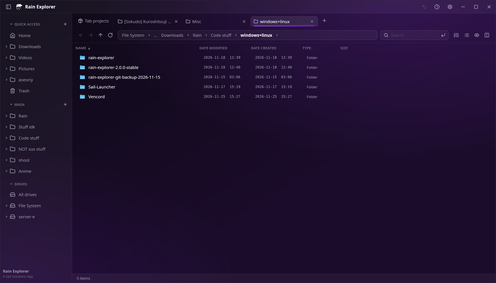

# Rain Explorer

Rain Explorer is a file manager for **Windows and Linux**, built with C# and .NET 10. It puts tabs, split panes, Quick Access, previews, Git and file operations into one workspace, with the same glass look and themes on both platforms.

The Windows app uses WPF. The Linux app uses Avalonia and follows Linux desktop conventions for the trash, app launching, icons and removable drives. Both are on **version 2.0.0**.



*The screenshot above shows the Linux app.*

Website: [rain-explorer.sailhub.fyi](https://rain-explorer.sailhub.fyi/)

## Features

### On both platforms

- **Browsing** — Home and Drives pages, breadcrumbs with an editable address bar, search (optionally including subfolders), natural sorting, and Details / List / Tiles / Grid layouts.
- **Tabs and panes** — Pinned tabs, tab groups, tab previews, reopening closed tabs, tear-off windows, split panes and saved **tab projects**. Tabs and panes can be restored when Rain starts.
- **Quick Access** — Pins with custom names and icons, extra sidebar lists, and drag-and-drop to pin, reorder and move things between lists.
- **File operations** — Copy, cut, paste, drag and drop, rename, new files and folders, trash / recycle bin, permanent delete, and undo/redo. Conflicts can be replaced, skipped or kept both.
- **Batch rename** — Select several files and press F2: find and replace (with regex), change case, add numbers or change extensions, with a live preview and one-step undo.
- **Command box** — Press Ctrl+` to run commands in the folder you're looking at; `cd` moves the pane with you.
- **Git and GitHub** — Status badges, a changes window for staging, commits, branches and pushes, cloning and creating repositories, and Git errors explained in plain words.
- **Previews** — Photos, text and code, PDFs, and audio/video details in the preview pane (Space), plus a Properties dialog.
- **Activity Center** — Progress, pause and cancel for file work, optional detailed history with plain-English error explanations. Pin it open or pop it out into its own window.
- **Make it yours** — Ten themes, density, interface font (search the list or import your own), smooth scrolling, a performance mode, and **every keyboard shortcut is customizable** (Settings → Shortcuts, or F1 for the full list).
- **Settings** — Search box to jump to any setting, and one-file **backup and restore** of your settings, pins, lists, tab projects and shortcuts.
- **Updates** — Rain checks GitHub for new versions, with an optional beta channel.

### Windows

- **Rain Archives** — Browse ZIP, 7z, RAR, TAR, GZIP, BZIP2 and XZ archives like folders, preview text inside them, test them and extract just the files you pick. Create ZIP, 7z, TAR, TAR.GZ, TAR.BZ2, TAR.XZ, GZIP, BZIP2 and XZ archives (7z and XZ use the official 7-Zip engine bundled with Rain; RAR needs WinRAR 7.23+). Every new archive is read back and checked before it's kept, and archives are opened by a separate, isolated worker process.
- **One-click Compress to / Extract to** — Right-click → Rain Archives has `Compress to "name.zip"` (and .7z, .tar.gz, .tar.xz and the rest) and `Extract to "name\"`, and only shows what fits what you clicked.
- **Shell integration** — Native right-click menus with "Show more options", an optional Rain Archives submenu, optional archive associations, and an option to make Rain your default file manager.
- **Network shares** — Type `\\server` or `\\server\share` in the address bar; Windows handles sign-in.

### Linux

- The FreeDesktop trash, shared with Dolphin and Nautilus, and clipboard copy/paste that works with other file managers.
- Your desktop icon theme (including SVG icons), removable drives through UDisks2 (mount, unmount, safely remove), and an Open with… app chooser.
- Network locations: type `smb://`, `sftp://`, `ftp://` or `dav://` addresses. Connected shares appear under Drives.
- Archive actions through your desktop's archive app (Ark, File Roller, Engrampa or Xarchiver).
- Optional Show in folder support and a one-click "Make Rain my default file manager". Installing alone never changes your defaults.
- The AppImage can update itself in place; the .deb update is handed to your system installer.

## Downloads and installation

Get the latest release from the [Releases page](https://github.com/Aseoriy/Rain-Explorer/releases).

### Windows

Download `RainExplorer-Setup-2.0.0.exe` and run it. The installer is per-user, doesn't need administrator access, and includes the .NET runtime. It isn't code-signed yet, so SmartScreen may warn you; choose **More info → Run anyway**.

Requires Windows 10 version 1809 or newer, x64.

### Linux

Linux packages are **x64 / amd64** and bundle the .NET runtime. Pick one:

| Package | How to install |
|---|---|
| `.AppImage` | Make it executable and run it. No root needed, and it can update itself. |
| `.deb` | Install with apt on Debian / Ubuntu. Adds the app-menu entry and a `rain-explorer` command. |
| `.tar.gz` | Extract and run `install.sh` for a per-user install, or run `app/RainExplorer` directly. |

**AppImage**

```bash
chmod +x rain-explorer-2.0.0-linux-x64.AppImage
./rain-explorer-2.0.0-linux-x64.AppImage
```

If your system can't mount AppImages through FUSE, add `--appimage-extract-and-run`.

**Debian / Ubuntu**

```bash
sudo apt install ./rain-explorer_2.0.0_amd64.deb
```

Remove it with `sudo apt remove rain-explorer`. Your settings are kept.

**Per-user / portable**

```bash
tar -xzf rain-explorer-2.0.0-linux-x64.tar.gz
cd rain-explorer-2.0.0-linux-x64
./install.sh
```

This installs to `~/.local/share/rain-explorer`, adds `rain-explorer` to `~/.local/bin` and creates an app-menu entry. Run `./install.sh --uninstall` from the same folder to remove it; your settings are kept.

**Checking your download**

Download the matching `.sha256` file next to your package, then:

```bash
sha256sum --ignore-missing -c rain-explorer-2.0.0-linux-x64.sha256
```

**Optional helpers** — `poppler-utils` (PDF preview), `gvfs-backends` (network locations), `git` (Git tools) and `ffmpeg` (video thumbnails). Rain works without them; those features just stay off.

## Keyboard shortcuts

These are the defaults. Change any of them in **Settings → Shortcuts**, and press **F1** in Rain to see your current ones.

| Action | Shortcut |
|---|---|
| New tab / close tab / reopen closed tab | Ctrl+T / Ctrl+W / Ctrl+Shift+T |
| Next / previous tab | Ctrl+Tab / Ctrl+Shift+Tab |
| Back / forward / up | Alt+Left / Alt+Right / Alt+Up |
| Edit address / search | Ctrl+L / Ctrl+F |
| Refresh / split view | F5 / F3 |
| Rename / batch rename | F2 / Shift+F2 (or F2 with several files selected) |
| Delete / delete permanently | Delete / Shift+Delete |
| Copy / cut / paste / copy path | Ctrl+C / Ctrl+X / Ctrl+V / Ctrl+Shift+C |
| Undo / redo | Ctrl+Z / Ctrl+Y |
| New folder / properties | Ctrl+Shift+N / Alt+Enter |
| Preview pane / hidden files / sidebar | Space / Ctrl+H / Ctrl+B |
| Settings / Activity Center | Ctrl+, / Ctrl+Shift+A |
| Command box / terminal here | Ctrl+` / Shift+F4 |
| All shortcuts | F1 |

## Building from source

Run these from the repository root, alongside `windows/` and `linux/`. You need the **.NET 10 SDK**.

### Windows

Requires Windows 10 version 1809 or newer. The Rain Archives engine is in [`rain-archives/`](rain-archives) and builds with the app; its worker is copied into `worker\` on build and publish. Inno Setup 6 is only needed for the installer.

```powershell
dotnet build windows\Main\RainExplorer.csproj -c Release
dotnet publish windows\Main\RainExplorer.csproj -c Release -r win-x64 --self-contained true -o windows\dist\app-sc
dotnet test windows\Tests\RainExplorer.Git.Tests\RainExplorer.Git.Tests.csproj -c Release
```

Then compile [`windows/Installer/RainExplorer.iss`](windows/Installer/RainExplorer.iss) with Inno Setup 6. The installer is written to `windows/dist/`.

### Linux

Use a Linux desktop with the usual GUI libraries, fonts, `xdg-utils` and the shared MIME database.

```bash
dotnet build linux/Main/RainExplorer.csproj -c Release
dotnet run --project linux/Main/RainExplorer.csproj
dotnet test linux/Tests/RainExplorer.Tests/RainExplorer.Tests.csproj -c Release
```

Build the tarball, AppImage, .deb (when `dpkg-deb` is installed) and checksum file:

```bash
./linux/packaging/build.sh
```

Output goes to `linux/dist/`. The first AppImage build downloads pinned, checksum-verified AppImage tools (needs `curl`) and caches them; set `BUILD_APPIMAGE=0` to skip the AppImage. Use `RID=linux-arm64` to build ARM64 packages for testing.

## Configuration

| Platform | Settings file |
|---|---|
| Windows | `%APPDATA%\RainExplorer\settings.json` |
| Linux | `~/.config/RainExplorer/settings.json` (`$XDG_CONFIG_HOME` is honoured) |

Settings are written atomically. A settings file that can't be read is kept as `settings.json.corrupt` instead of being replaced with defaults, and restoring a backup keeps the old file as `settings.json.before-restore`. Uninstalling keeps your settings.

## Repository layout

```text
windows/
  Main/          WPF application
  Installer/     Inno Setup script
  Tests/         Windows tests
linux/
  Main/          Avalonia application
  Tests/         Linux service and headless UI tests
  packaging/     Build and install scripts, desktop entry and icons
  tools/         Icon conversion tool
rain-archives/   Rain Archives engine and worker (Windows)
README.md        Repository overview
Preview.png      Application preview (Linux)
```

## Known limits

- Built-in archive browsing is Windows-only. Linux hands archives to your desktop's archive app.
- Archive browsing is read-only, and creating encrypted or split archives isn't available yet.
- Linux downloads are x64 / amd64 only. Linux testing was done on Ubuntu (KDE and GNOME).
- Neither build is code-signed yet.

## License

No license has been added to this repository yet. All rights are reserved by the project author unless a separate license is provided.

Rain Archives bundles third-party components (7-Zip, SharpSevenZip, SharpCompress). Their licenses are in [`rain-archives/licenses`](rain-archives/licenses) and [`rain-archives/THIRD-PARTY-NOTICES.md`](rain-archives/THIRD-PARTY-NOTICES.md), and they ship with the Windows app.
